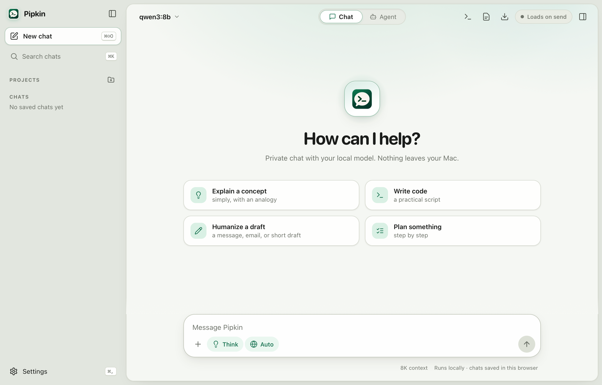
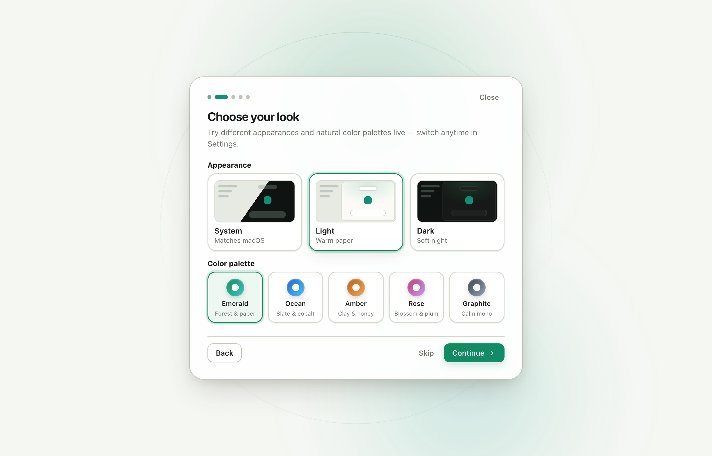

  

<h1 align="center">Pipkin</h1>

<strong>Local AI chat and a workspace agent for macOS and Windows.</strong> 
Turn your own files into finished work with a model that runs on your machine.

  <a href="https://github.com/garywu000/pipkin/releases/tag/v2.0.4"><strong>Download v2.0.4</strong></a> ·
  <a href="#get-started">Get started</a> ·
  <a href="#chat-and-projects">Features</a> ·
  <a href="#try-site">Try /site</a> ·
  <a href="#version-history">Version history</a> ·
  <a href="#build-from-source">Build from source</a>

Pipkin is a desktop app for [Ollama](https://ollama.com) on macOS and Windows. Use **Chat** for questions, writing, and research. Use **Agent** to plan a task, work inside a folder you choose, and review the files it saves. Local models run on your computer.

## Get started

### macOS

1. Download [Pipkin for Apple silicon](https://github.com/garywu000/pipkin/releases/download/v2.0.4/Pipkin-macos-arm64.zip), unzip it, and open **Pipkin.app**. This preview is ad-hoc signed. If macOS blocks the download, use the [source build](#build-from-source).
2. Install [Ollama for macOS](https://ollama.com/download/mac) and download a local model. First-run setup has an Ollama guide if no model is installed.

### Windows

1. On an x64 PC running Windows 11 or Windows 10 22H2, install [Ollama for Windows](https://ollama.com/download/windows) and [Python 3.9 or later](https://www.python.org/downloads/windows/) with **Add Python to PATH**. Install the [WebView2 Runtime](https://developer.microsoft.com/en-us/microsoft-edge/webview2/) if it is missing (pre-installed on Windows 11). The Windows ZIP is self-contained — no separate .NET install is required.
2. Download [Pipkin for Windows x64](https://github.com/garywu000/pipkin/releases/download/v2.0.4/Pipkin-windows-x64.zip), extract the full **Pipkin** folder, and double-click **Pipkin.exe**. Pipkin manages its own local server, so opening a terminal is only needed for tasks such as downloading a model.

See the [Windows guide](windows/README.md) for details. The [Windows build and test run](https://github.com/garywu000/pipkin/actions/runs/45325460976) produced the ZIP attached to v1.9.0.

### Choose a model and start

For a first model, try `ollama pull qwen3:8b` if it fits your computer. Agent needs a model that supports tool calls. Choose **Chat** or **Agent** in Pipkin. For Agent, select a folder and use **Ask first** to review proposed changes. Pipkin loads the model on demand. Click the model status and choose **Unload model** to free model memory during a session.

### Customize your first launch

Choose **Light**, **Dark**, or **System** appearance, then preview **Emerald**, **Ocean**, **Amber**, **Rose**, and **Graphite** palettes. Pipkin remembers your choice. You can change it in **Settings → General** or replay the walkthrough from **Welcome setup**.

The setup walkthrough also lets you pick an installed model, choose your default Chat or Agent mode, and set personal preferences. On Windows, the app uses Windows shortcut labels and a matching Light or Dark title bar. Rebind shortcuts under **Settings → General → Keyboard shortcuts**.

## Chat and projects

- **Saved history.** Reopen chats after quitting. Search, pin, rename, or delete them from the sidebar. Edit an earlier prompt to branch the conversation. Drag the sidebar edge to resize it, and hover over a clipped title to see it scroll. Browse other chats during a live reply or Agent run and use **Return to live run** to jump back.
- **Projects and context.** Group chats by dragging them into projects. Add shared project notes and give individual chats their own goals and instructions. Context compaction summarizes older turns when the window fills.
- **Attachments and long pastes.** Attach files or photos from one picker, or drag them into the composer. Pastes over 10,000 characters become previewable text attachments. Pipkin keeps the full paste with the chat and labels any excerpt sent to the model. Photos require a model with vision support.
- **Readable replies and citations.** Markdown renders during streaming, and LaTeX renders equations. Expand the collapsed thinking panel to see its duration and contents. When using web research or attached sources, open citations to see the linked page or source excerpt.
- **Skills and model controls.** Type `/` to choose a built-in or custom skill. `/humanize` helps rewrite messages, and `/humanize-paper` handles academic drafts. Select an installed model, adjust its context and temperature, and toggle thinking or web search in the app.

## Agent and the Harness panel

- **Plan, approve, and steer.** Follow the pinned checklist and progress updates while routine actions stay grouped in expandable batches. With **Ask first**, review each proposed edit or command. Send a steering note between steps, stop after the current step, or resume from a checkpoint.
- **Build and open outputs.** Ask in plain language for a website, Word document, PowerPoint deck, or PDF. The Work result card links to saved files and displays completed checks and sources. HTML saves check local links, assets, and anchors during regular Agent work too.
- **Undo per file or per run.** Undo restores edits or removes files created by the run. Pipkin checks for later changes first. If **Undo All** stops partway through, the result card shows the completed, failed, and skipped actions.
- **Working notes.** The Agent can save short findings and automatically track files and line ranges it has read. These notes survive context trimming and saved checkpoints. Open **Working notes** beneath the plan to see what the run kept.
- **Optional two-model runs.** In **Settings → Model → Explorer model**, pick a smaller installed local model to map and read files on eligible workspace runs. Your primary model takes over for writing. This is off by default and can be compared with a single-model run using the [benchmark harness](benchmarks/README.md).
- **Keep long runs moving.** Pipkin reuses tool results when possible, avoids repeating successful commands in an unchanged workspace, and detects repetitive generation. Model steps pause after three minutes without output or five minutes of active work. A run can work for up to ten minutes, excluding approval waits. Pipkin requests that the system stay awake while Agent works.

Open the **Harness panel** with **⌘⇧P** on macOS or **Ctrl+Shift+P** on Windows. **Review** and **Open File** surface your workspace outputs. **Terminal** docks a shell and **Chat Context** opens the current chat’s goal and notes. The Mac app includes a native, tabbed **Browser** pane. Windows opens web links in your default browser.

The Mac app can notify you when a run needs approval. **Sprig**, the optional desktop pet, offers shortcuts back to Chat and Agent.

## Model memory and token usage

Click the model status in the top bar to see memory pressure, loaded Ollama models, and their reported memory use. On macOS the graph also shows app, wired, compressed, and cached memory alongside swap use. Windows reports RAM and pagefile use. The popover provides **Unload model** and a shortcut to model settings.

**Memory protection** is on by default. Pipkin can block a new model load when memory is already critical, pause Agent and save a checkpoint if pressure remains critical, and unload an idle model. The warning banner offers a memory graph and a suggested smaller context window when available.

**Settings → Usage** shows the lifetime total of input and generated tokens reported by Ollama since tracking began. Deleting a chat leaves those totals intact.

The screenshots show the macOS interface with sample chats, files, and model details.

## Try /site

Copy [the sample brief](examples/study-session/brief.md) into an empty folder and choose that folder in Agent. Ask Pipkin to build the page in plain language.

~~~text
Build a printable Study Session page in index.html using brief.md.
Include the meeting time and checklist. Make it readable on a phone and
link back to brief.md. Use HTML and CSS, verify the local link, and
report the saved page.
~~~

Pipkin plans the work, shows the proposed `index.html` as a diff for your approval, and finishes with a link that opens the saved page.

> [!NOTE]
> Pipkin detects straightforward site requests and renders a first page from a checked content plan. Work’s editor handles interactive sites, larger projects, and updates to existing pages. You can also select `/site` from the slash menu.

## Create a document, study guide, or presentation

Select an Agent workspace and attach or place your source material in the folder. Then ask for the output directly.

- “Create a Word report named `meeting-notes.docx` from the attached notes.”
- “Make a five-slide PowerPoint from `brief.md`.”
- “Create a printable PDF handout from `brief.md`.”
- “Turn the attached syllabus into a study guide with review questions.”
- “Use this PDF packet to make an interactive checklist of requirements and deadlines.”

Pipkin previews the content for approval in **Ask first**, saves the file, and shows a clickable output. `/word`, `/powerpoint`, and `/pdf` are optional shortcuts. Office exports use editable text and templates. The PowerPoint template supports one to nine slides. Check the names, numbers, and wording in the preview before approving.

Use `/study-guide` or `/checklist` for navigable HTML with a contents list and a source index. Each section cites its evidence. For PDF sources, links open the relevant page, and checklist items are interactive. Windows can extract text from supported PDFs and render new PDFs with built-in Python support. Scanned pages need a text or OCR layer for document extraction.

## Privacy and permissions

- Local model inference, chat history, settings, and token totals stay on your computer. Web search, page fetches, and the browser contact the sites involved.
- **Update check.** When Pipkin opens, it asks GitHub Releases for the latest version number (no chats, files, or settings are sent) and shows a notice if a newer one exists. Turn it off in **Settings → General → Check for updates**; Pipkin then makes no update requests.
- Agent file tools are scoped to your selected workspace. On Windows, these tools reject paths through symbolic links and junctions, drive escapes, and reserved device names.
- **Shell commands are off by default.** Enable them in **Settings → Agent → Allow shell commands**. Agent commands require approval and show a scope preview. The macOS workspace command runner restricts writes to the workspace and a temporary directory and blocks network access. On Windows, approved PowerShell workspace commands start in the workspace with a reduced environment and use your Windows account’s file and network permissions.

See [SECURITY.md](SECURITY.md) to report a vulnerability.

## Version history

| Version | What changed |
| --- | --- |
| [v2.0.4](https://github.com/garywu000/pipkin/releases/tag/v2.0.4) | A new look: the chat sits on a floating sheet framed by the window, warm paper-toned surfaces tinted by your palette, refreshed Emerald, Ocean, Amber, Rose, and Graphite colors in light and dark, rounded headings on macOS, icons on the starter cards, and a pill Chat/Agent switch. Theme changes cross-fade smoothly. Fixes: equations render at a readable size with a proper math font, the scroll-to-bottom button no longer lingers on an empty chat, the side panel search box lost its double outline, the narrow-window side panel stays opaque, and the window title bar always matches the theme. |
| [v2.0.3](https://github.com/garywu000/pipkin/releases/tag/v2.0.3) | Update notice: Pipkin checks GitHub Releases when it opens and shows a dismissible banner when a newer version is available, with a switch and **Check now** button in **Settings → General**. Small-model fixes: a reply that ends with “Next step: …” is sent back to finish the work, and edits recover when a model double-escapes line breaks. |
| [v2.0.2](https://github.com/garywu000/pipkin/releases/tag/v2.0.2) | Work reliability with small local models, found by running live Qwen 8B tasks: file tools read PDFs and Word files; Work never rewrites an existing file the model has not read, and `write_page` cannot replace an existing page; models that promise a next step, claim a change that did not happen, or skip a requested file are sent back or corrected; edits tolerate indentation slips; failed edits show the current file; `read_files` reads the first four ranges instead of failing; `write_page` supports links; tests no longer leave cache folders. Includes `benchmarks/sim.py` for live task simulations. |
| [v2.0.1](https://github.com/garywu000/pipkin/releases/tag/v2.0.1) | Security hardening: web fetches connect only to the public address they were checked against (blocks DNS-rebinding access to localhost and your network), approved Mac commands can no longer launch or script other apps to leave the sandbox, imported backups keep this device's shell, approval, and web settings, file writes re-check hard links after opening, and settings and transfers are saved atomically and privately. New backups use 600,000 PBKDF2 iterations and passphrases need 8+ characters. Long replies render with less CPU while streaming. |
| [v2.0.0](https://github.com/garywu000/pipkin/releases/tag/v2.0.0) | Cross-device backup & handoff without a cloud account: optional client-side AES-256-GCM encrypted `.pipkin-backup` files, smart import preview & merge, and Folder Handoff (iCloud Drive, OneDrive, Dropbox, or USB). Self-contained Windows ZIP (no separate .NET install) with native `.ico` icon, MIT `LICENSE`, updated `SECURITY.md`, and dual macOS + Windows CI. |
| [v1.9.0](https://github.com/garywu000/pipkin/releases/tag/v1.9.0) | Windows gained workspace Agent support, native folder selection, file verification and undo, PDF reading and writing, PowerShell, Windows shortcut labels, and taskbar attention indicators. The published Windows ZIP includes follow-up fixes for checkpoint saving, SQLite locking, and PowerShell output handling. |
| [v1.8.0](https://github.com/garywu000/pipkin/releases/tag/v1.8.0) | First Windows Chat preview using WebView2. A shared platform layer handles app data, model discovery, memory, and native file opening. Added Windows packaging and CI. |
| [v1.7.1](https://github.com/garywu000/pipkin/releases/tag/v1.7.1) | Custom keyboard shortcuts with conflict detection and reset, Settings layout fixes, local-only Explorer selection, and protection against deleting a chat while its run is active. |
| [v1.7.0](https://github.com/garywu000/pipkin/releases/tag/v1.7.0) | Browse other chats during a live run, return to an active run from the banner, and optionally use an Explorer model. Benchmarks gained `--explore-model`. |
| [v1.6.1](https://github.com/garywu000/pipkin/releases/tag/v1.6.1) | Added the live Mac RAM graph, an Activity Monitor-style memory breakdown, and a **Memory graph** shortcut in the warning banner. |
| [v1.6.0](https://github.com/garywu000/pipkin/releases/tag/v1.6.0) | Added document-first study guides and interactive checklists with per-section citations, PDF page links, and local link verification. |
| [v1.5.0](https://github.com/garywu000/pipkin/releases/tag/v1.5.0) | Separated shell access into its own opt-in. Added macOS workspace command isolation, a reduced shell environment, and approval cards that preview the command’s scope. |
| [v1.4.0](https://github.com/garywu000/pipkin/releases/tag/v1.4.0) | Added working notes and a file-read ledger that survive context trimming and resuming. |
| [v1.3.0](https://github.com/garywu000/pipkin/releases/tag/v1.3.0) | Added a guard against starting new model loads under critical memory pressure, the memory warning banner, and stricter native browser link handling. Included the v1.2.1 development changes for pausing runs, unloading idle models, and recommending context sizes. |
| [v1.2.0](https://github.com/garywu000/pipkin/releases/tag/v1.2.0) | Redesigned the Mac interface with five palettes and first-launch customization. Added the Harness launcher, live model memory display, and Undo All. |

## Roadmap

- **Distribution.** Signed and notarized Mac builds, Windows installer improvements, and a project license.
- **Benchmark comparisons.** Publish repeated trials with the same hardware, model, context, and task when comparing single-model and Explorer runs.
- **Connected accounts.** Read-first access to GitHub and Google Workspace, with reviewed writes.
- **Extensibility.** Shareable skills, scheduled work, and moving conversations between devices.

Have an idea or a task Pipkin should finish? [Open an issue](https://github.com/garywu000/pipkin/issues).

## Build from source

On macOS, install the Xcode Command Line Tools and Ollama. On Windows, follow the [Windows build guide](windows/README.md).

~~~sh
git clone https://github.com/garywu000/pipkin.git
cd pipkin
sh shell/package.sh
open build/Pipkin.app
~~~

The packaging script also writes a zip named for your build architecture. To run the regression tests:

~~~sh
PYTHONDONTWRITEBYTECODE=1 python3 -m unittest discover -s tests
~~~

### Repository layout

| Path | Role |
| --- | --- |
| [`shell/`](shell/) | Native window, browser pane, Sprig, and macOS packaging |
| [`dist/`](dist/) | Chat UI, skill menu, terminal panel, and Agent timeline |
| [`server.py`](server.py) | Loopback server, Ollama session, terminal, and approvals |
| [`platform_os.py`](platform_os.py) | Platform-specific data paths, file opening, memory, and PDF support |
| [`windows/`](windows/) | Windows WebView2 host and ZIP packaging |
| [`agent.py`](agent.py) | Agent loop, workspace tools, context management, recovery, undo, and site checks |
| [`artifacts.py`](artifacts.py) | Content plans and rendering for sites, Word, PowerPoint, and PDF |
| [`benchmarks/`](benchmarks/) | Work benchmark tasks, graders, and recorded baselines |
| [`tests/`](tests/) | Agent and workspace regression tests |
| [`docs/screenshots/`](docs/screenshots/) | Images used in this README |

## License

Project licensing is still being decided. Bundled libraries have their own [license notices](THIRD_PARTY_NOTICES.md).
