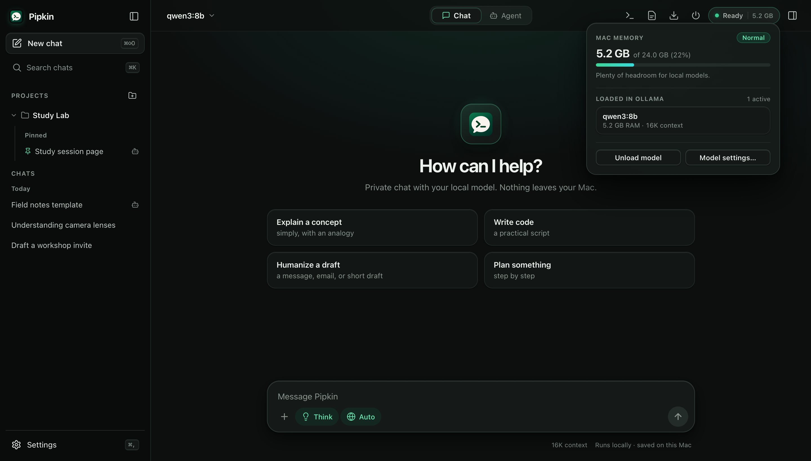

  

<h1 align="center">Pipkin</h1>

<strong>A local AI chat and workspace agent for the Mac you already have.</strong> 
Turn your own files into finished work with a model that runs on your machine.

  <a href="https://github.com/garywu000/pipkin/releases/tag/v1.2.0"><strong>Download v1.2</strong></a> ·
  <a href="#get-started">Get started</a> ·
  <a href="#chat-and-projects">Features</a> ·
  <a href="#try-site">Try /site</a> ·
  <a href="#roadmap">Roadmap</a> ·
  <a href="#build-from-source">Build from source</a>

Pipkin is a native macOS app for [Ollama](https://ollama.com). Use **Chat** for questions, writing, and research. Use **Agent** to plan a task, work inside a folder you choose, and review the files it saves. Model inference runs on your Mac.

## Get started

1. Download [Pipkin v1.2](https://github.com/garywu000/pipkin/releases/tag/v1.2.0), unzip it, and open **Pipkin.app**. The download is an ad-hoc-signed preview for Apple silicon. If macOS blocks it, follow the [build instructions](#build-from-source).
2. The first time you open Pipkin, a skippable setup screen lets you preview a look, pick your default mode, select an installed model, and set your preferences. The model step includes a guide for installing [Ollama for macOS](https://ollama.com/download/mac) and downloading your first model.
3. Choose **Chat** or **Agent**. For Agent, choose a project folder and use **Ask first** to review edits and commands as the run progresses.

For a first model on a 16 GB Mac, try `ollama pull qwen3:8b`. Agent works best with a model that supports tool calls.

Pipkin loads the model when you send a request. To free model memory during a session, click the model status and choose **Unload model**. Quitting Pipkin also unloads its model.

### Customize your first launch

Choose **Light**, **Dark**, or **System** appearance, then preview **Emerald**, **Ocean**, **Amber**, **Rose**, and **Graphite** palettes. Pipkin remembers your choice. You can change it in **Settings → General** or replay the walkthrough from **Welcome setup**.

The v1.2 redesign includes the animated setup intro, centered conversation and composer, smoother Chat and Agent transitions, updated controls, a cleaner Agent timeline, and a redesigned native browser tab strip and address bar. The main interface respects **Reduce Motion**.

## Chat and projects

- **Saved history.** Reopen chats after quitting. Search, pin, rename, or delete them from the sidebar. Edit an earlier prompt to branch the conversation. Drag the sidebar edge to resize it, and hover over a clipped title to see it scroll.
- **Projects and context.** Group chats by dragging them into projects. Add shared project notes and give individual chats their own goals and instructions. Context compaction summarizes older turns when the window fills.
- **Attachments and long pastes.** Attach files or photos from one picker, or drag them into the composer. Pastes over 10,000 characters become previewable text attachments. Pipkin keeps the full paste with the chat and labels any excerpt sent to the model. Photos require a model with vision support.
- **Readable replies and citations.** Markdown renders during streaming, and LaTeX renders equations. Expand the collapsed thinking panel to see its duration and contents. When using web research or attached sources, open citations to see the linked page or source excerpt.
- **Skills and model controls.** Type `/` to choose a built-in or custom skill. `/humanize` helps rewrite messages, and `/humanize-paper` handles academic drafts. Select an installed model, adjust its context and temperature, and toggle thinking or web search in the app.

## Agent and the Harness panel

- **Plan, approve, and steer.** Follow the pinned checklist and progress updates while routine actions stay grouped in expandable batches. With **Ask first**, review each proposed edit or command. Send a steering note between steps, stop after the current step, or resume from a checkpoint.
- **Build and open outputs.** Ask in plain language for a website, Word document, PowerPoint deck, or PDF. The Work result card links to saved files and displays completed checks and sources. HTML saves check local links, assets, and anchors during regular Agent work too.
- **Undo per file or per run.** Undo restores edits or removes files created by the run. Pipkin checks for later changes first. If **Undo All** stops partway through, the result card shows the completed, failed, and skipped actions.
- **Keep long runs moving.** Pipkin reuses recent tool results when possible, avoids repeating successful commands in an unchanged workspace, and detects repetitive generation. Model steps pause after three minutes without output or five minutes of active work. A run can work for up to ten minutes, excluding approval waits, and Pipkin prevents idle sleep while it runs.

Open the **Harness panel** with **⌘⇧P**. **Review** and **Open File** surface outputs from your workspace. **Terminal** docks a shell in the launcher. **Browser** opens a separate native pane, and **Chat Context** lets you edit the current chat’s goal and notes. The search box filters tools or accepts a URL or search query.

The Mac app can notify you when a run needs approval. **Sprig**, the optional desktop pet, offers shortcuts back to Chat and Agent.

## Model memory and token usage

Click the model status in the top bar to see which models are loaded, their reported memory use, and current macOS memory pressure. Open model settings or unload the model from the same popover.

**Settings → Usage** shows the lifetime total of input and generated tokens reported by Ollama since tracking began. Deleting a chat leaves those totals intact.

The screenshots show the v1.2 interface with sample chats, files, and model details.

## Try /site

Copy [the sample brief](examples/study-session/brief.md) into an empty folder and choose that folder in Agent. Ask Pipkin to build the page in plain language.

~~~text
Build a printable Study Session page in index.html using brief.md.
Include the meeting time and checklist. Make it readable on a phone and
link back to brief.md. Use HTML and CSS, verify the local link, and
report the saved page.
~~~

Pipkin plans the work, shows the proposed `index.html` as a diff for your approval, and finishes with a link that opens the saved page.

> [!NOTE]
> Pipkin detects straightforward site requests and renders a first page from a checked content plan. Work’s editor handles interactive sites, larger projects, and updates to existing pages. You can also select `/site` from the slash menu.

## Create a document or presentation

Select an Agent workspace, then ask for the output directly.

- “Create a Word report named `meeting-notes.docx` from the attached notes.”
- “Make a five-slide PowerPoint from `brief.md`.”
- “Create a printable PDF handout from `brief.md`.”

Pipkin previews the content for approval in **Ask first**, saves the file, and shows a clickable output. `/word`, `/powerpoint`, and `/pdf` are optional shortcuts. Office exports use editable text and templates. The PowerPoint template supports one to nine slides. Check the names, numbers, and wording in the preview before approving.

## Privacy and permissions

- Model inference runs locally through Ollama. Chat history, settings, and token totals are stored on your Mac.
- Web search, page fetches, and the built-in browser contact the sites involved. Use the web control to turn automatic search off.
- Agent file operations stay inside the workspace folder you select. Approved shell commands run with your macOS account’s permissions. Use **Ask first** to review those commands.

See [SECURITY.md](SECURITY.md) to report a vulnerability.

## Roadmap

Pipkin's bet: the most useful local agent is the one that **finishes**. Each release is judged on how often a mid-size model completes a real task on an everyday Mac, how long that takes, and whether the Mac stays responsive.

### v1.1: reliable deliverables (released)

- **Staged file creation** for sites, Word, PowerPoint, and PDF, with rendering and file checks handled by Pipkin.
- **A Work benchmark.** [Six fixture tasks](benchmarks/README.md) graded on the files they leave on disk, with time to first verified output, total time, and memory use.
- **Result cards you can trust and undo**, plus plan-first runs and recovery from stuck actions.

### After v1.2

- **Signed and notarized builds**, a clean-Mac install guide, and a chosen license.
- **Live benchmark comparisons** with matched model, context, and Mac settings, published with the results.

### v2: Windows, long documents, and long runs

- **Windows app.** Start with local Chat, then add folder-based Agent work with approvals and undo.
- **Document-first workflows.** Drop in a PDF packet, syllabus, or brief and get a navigable site, a study guide, or a checklist, with every claim linked to its page.
- **Working memory that survives trimming.** The agent keeps short notes of what it has learned, so it stops re-reading files it already read.
- **Memory-pressure awareness.** Pipkin shows when the Mac is under pressure and pauses or unloads the model before the system starts swapping.
- **Two-model runs.** A small model explores and a larger one writes, but only if the benchmark shows it finishes more tasks.
- **Safer shell access.** Commands become a separate opt-in, run in an isolated environment, and come with a clear list of what they may touch.

### v3: connected and extensible

- **Read-first connectors** for GitHub, Google Drive, and Calendar: summarize, plan, and draft locally. Writing back always needs approval.
- **Shareable skills.** A small file format for workflows like `/site`, with their own checks, so people can publish and install them.
- **Scheduled and background tasks**, such as "every Friday, turn this week's notes into a review sheet", with a summary waiting for you.
- **Pick up where you left off** on another Mac, without a cloud account.

Have an idea or a task Pipkin should finish? [Open an issue](https://github.com/garywu000/pipkin/issues).

## Build from source

The app targets macOS 12 or later. The v1.2 download was built and tested on Apple silicon. You need the Xcode Command Line Tools and Ollama.

~~~sh
git clone https://github.com/garywu000/pipkin.git
cd pipkin
sh shell/package.sh
open build/Pipkin.app
~~~

The packaging script also writes a zip named for your build architecture. To run the regression tests:

~~~sh
PYTHONDONTWRITEBYTECODE=1 python3 -m unittest discover -s tests
~~~

### Repository layout

| Path | Role |
| --- | --- |
| [`shell/`](shell/) | Native window, browser pane, Sprig, and macOS packaging |
| [`dist/`](dist/) | Chat UI, skill menu, terminal panel, and Agent timeline |
| [`server.py`](server.py) | Loopback server, Ollama session, terminal, and approvals |
| [`agent.py`](agent.py) | Agent loop, workspace tools, context management, recovery, undo, and site checks |
| [`artifacts.py`](artifacts.py) | Content plans and rendering for sites, Word, PowerPoint, and PDF |
| [`benchmarks/`](benchmarks/) | Work benchmark tasks, graders, and recorded baselines |
| [`tests/`](tests/) | Agent and workspace regression tests |
| [`docs/screenshots/`](docs/screenshots/) | Images used in this README |

## License

Project licensing is still being decided. Bundled libraries have their own [license notices](THIRD_PARTY_NOTICES.md).
