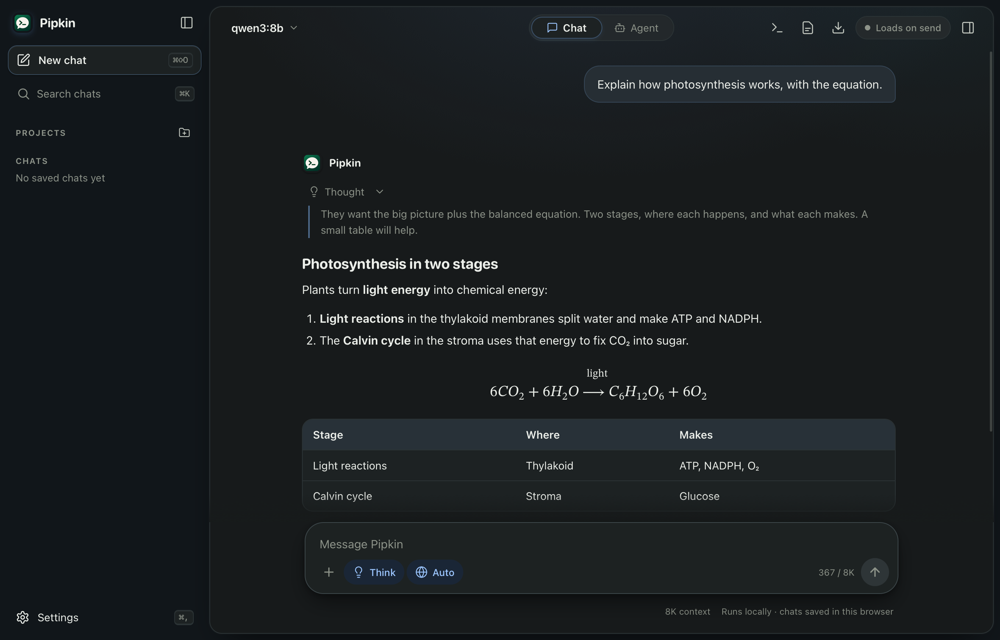
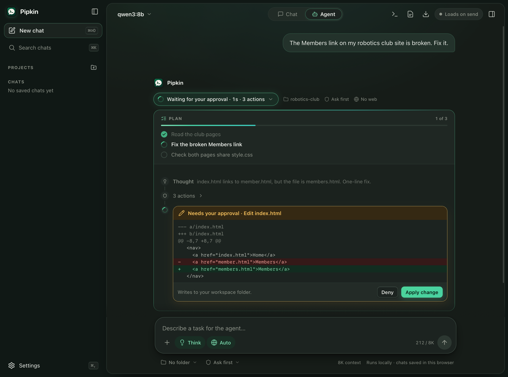
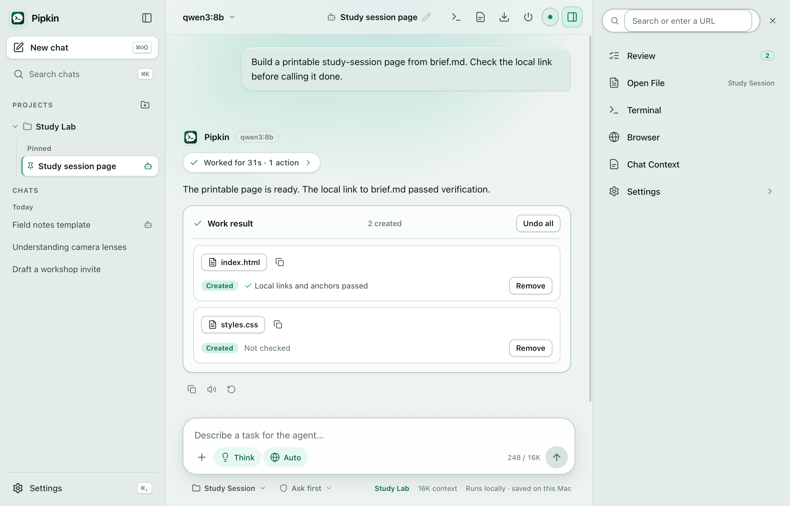

  

<h1 align="center">Pipkin</h1>

<strong>Local AI chat and a workspace agent for Mac and Windows.</strong> 
Chat with an Ollama model on your computer, or give Agent a folder and turn your files into a website, document, or presentation.

  
  

  <a href="https://github.com/garywu000/pipkin/releases/tag/v2.3.3"><strong>v2.3.3 release notes</strong></a> ·
  <a href="#get-started">Get started</a> ·
  <a href="#choosing-a-model-for-agent">Choose a model</a> ·
  <a href="#shareable-skills">Shareable skills</a> ·
  <a href="#try-site">Try /site</a> ·
  <a href="#build-from-source">Build from source</a>

## Get started

### 1. Install and open

| Platform | Install first | Open Pipkin |
| --- | --- | --- |
| **Mac · Apple Silicon** | Install and open [Ollama for macOS](https://ollama.com/download/mac). If macOS prompts for Command Line Tools to run Python, install them. | Extract the ZIP, move **Pipkin.app** to **Applications**, then open it. The Mac build is ad-hoc signed. If macOS blocks it, use the [source build](#build-from-source). |
| **Windows · x64** | On Windows 11 or Windows 10 22H2, install and open [Ollama for Windows](https://ollama.com/download/windows). Install [Python 3.9+](https://www.python.org/downloads/windows/) with **Add Python to PATH** and the [WebView2 Runtime](https://developer.microsoft.com/en-us/microsoft-edge/webview2/) if missing. | Extract the full **Pipkin** folder, then open **Pipkin.exe** inside it. The ZIP bundles .NET. See the [Windows setup guide](windows/README.md). |

### 2. Pick a local model

In Pipkin’s first-launch setup, choose your appearance and select an installed **Local Ollama model**. If the list is empty, open Ollama and download a model in Terminal on Mac or PowerShell on Windows. Start with the lightweight model below, or pick a model for your hardware from the [model guide](#choosing-a-model-for-agent).

~~~sh
ollama pull qwen3:4b-instruct
~~~

After the download, the model appears in Pipkin’s picker. Agent needs a model that supports tool calls.

### 3. Send your first prompt

- **Chat** lets you ask a question or attach a file. Try “Summarize this file in five bullets.”
- **Agent** works in a folder you select. Start with **Ask first** to review file changes, then [try a sample website task](#try-site).

Pipkin starts its local server automatically and loads your model when you send a prompt. Use **Unload model** in the model status menu to free model memory.

> [!TIP]
> Already using Pipkin? Open **Settings → General → Check for updates**. When the update appears, choose **Update now**, then **Restart to update**.

## Choosing a model for Agent

Agent needs an Ollama model with **tool calling** so it can read files, make edits, and run checks through Pipkin. Look for **tools** on the exact model tag. For example, standard `gemma3:4b` is a Chat option, and `gemma4:e2b-it-q4_K_M` supports Agent tool calls. The latter is a 4.6 GB download, so the 2.5 GB Qwen 4B leaves more room on a machine with 8 GB of RAM. [Ollama tool calling](https://docs.ollama.com/capabilities/tool-calling) · [Gemma 3 4B](https://ollama.com/library/gemma3:4b) · [Gemma 4 E2B](https://ollama.com/library/gemma4:e2b-it-q4_K_M)

### Find your hardware

- **Apple Silicon Mac:** Use the unified memory shown in **About This Mac**. The CPU, GPU, and other apps share it. [Ollama for macOS](https://docs.ollama.com/macos)
- **Windows with a dedicated GPU:** Open **Task Manager → Performance → GPU** and look for **Dedicated GPU memory** (VRAM). Use that number if Ollama supports the GPU. A PC with 64 GB of RAM and an 8 GB GPU starts in the **8 GB VRAM** range for GPU-backed runs. [Windows Task Manager](https://support.microsoft.com/en-us/accessibility/windows/use-a-screen-reader-to-navigate-windows-support-tools) · [Ollama GPU support](https://docs.ollama.com/gpu)
- **Windows with integrated graphics or CPU inference:** Use system RAM and leave room for Windows and other apps. Start with a 4B or 8B model even if you have 32 GB or more, since CPU inference can be slow on long jobs. While the model is loaded, run `ollama ps` and check **PROCESSOR** to see whether Ollama is using the GPU, CPU, or both. [Ollama for Windows](https://docs.ollama.com/windows) · [Checking model offload](https://docs.ollama.com/context-length#check-allocated-context-length-and-model-offloading)

### Pick a starting model

| Mac unified memory or Windows RAM without a dedicated GPU | Windows dedicated VRAM | Model and context to try | First tasks |
| --- | --- | --- | --- |
| **8–15 GB** | **4–6 GB** | [`qwen3:4b-instruct`](https://ollama.com/library/qwen3:4b-instruct) at **4K**. Try [`qwen3:1.7b`](https://ollama.com/library/qwen3:1.7b) if memory is tight. | Read a short file and save one checklist or summary. |
| **16 GB and up** for everyday work | **8–12 GB** | [`qwen3:8b`](https://ollama.com/library/qwen3:8b) at **8K**. | Build a simple site from a brief, make a focused edit, or draft a short document. |
| **32–63 GB on Mac** | **16 GB** for 12B. Try 27B at **24 GB**. | [`gemma4:12b`](https://ollama.com/library/gemma4:12b) or quantized [`qwen3.6:27b`](https://ollama.com/library/qwen3.6:27b) at **8K**. | Try a focused multi-file change or a document from several short sources. |
| **64 GB or more on Mac** | **32 GB or more** | Try [`qwen3.6:35b`](https://ollama.com/library/qwen3.6:35b) or [`gemma4:31b`](https://ollama.com/library/gemma4:31b) at **16K**. | Try larger tasks in stages, with a check for each output. |

**Leave headroom.** The download size is the model package. Running it also takes memory for the context window and other runtime overhead. In **Settings → Model → Context window**, start with the table value, leave **Explorer model** off, and keep **Memory protection** enabled. If the system slows down or Ollama offloads more work to the CPU than you expected, reduce context or try a smaller model. [Ollama context and memory](https://docs.ollama.com/context-length)

**Verify one small task before scaling up.** With **Ask first**, try “Save `checklist.md` with three bullets from `notes.md`.” Open the saved file to confirm it used the source. Small models can miss steps or repeat tool calls. Larger models can still make mistakes or hit Pipkin’s run limits.

The table gives starting points. Pipkin’s published live model runs used Apple Silicon, including a Qwen 8B resume task and a quantized Qwen 27B PDF-to-site task. Windows CI covers scripted Agent workflows. A live Windows model run will depend on the GPU, drivers, context, and available memory. [Live and scripted benchmarks](benchmarks/README.md) · [Windows CI](https://github.com/garywu000/pipkin/actions/runs/45648820283)

## Shareable skills

Type `/skills` to make a workflow reusable. Add your instructions and optional checks for saved files, local links, headings, text, word count, citation markers, or placeholders. In Agent, the **Skill checks** card shows the results. The general Work editor can ask the model for one correction when a check fails.

- **Share** a single skill as a `.pipkin-skill` or export your library as a `.pipkin-skill-pack`.
- **Import** by dropping the file into Pipkin or choosing **Import skill…**. The preview shows the skill’s instructions, checks, and flagged patterns before you install it.
- **Keep skills with a project** by saving them in its `.pipkin/skills/` folder. They appear with a **Folder** badge when you open that workspace.

See **Known limitations** in the [v2.1.0 release notes](https://github.com/garywu000/pipkin/releases/tag/v2.1.0) for the current verification and pack-import limits.

## Chat and projects

- **Saved history.** Reopen chats after quitting. Search, pin, rename, or delete them from the sidebar. Edit an earlier prompt to branch the conversation. Drag the sidebar edge to resize it, and hover over a clipped title to see it scroll. Browse other chats during a live reply or Agent run and use **Return to live run** to jump back.
- **Projects and context.** Group chats by dragging them into projects. Add shared project notes and give individual chats their own goals and instructions. Context compaction summarizes older turns when the window fills.
- **Attachments and long pastes.** Attach files or photos from one picker, or drag them into the composer. Pastes over 10,000 characters become previewable text attachments. Pipkin keeps the full paste with the chat and labels any excerpt sent to the model. Photos require a model with vision support.
- **Readable replies and citations.** Markdown renders during streaming, and LaTeX renders equations. Expand the collapsed thinking panel to see its duration and contents. When using web research or attached sources, open citations to see the linked page or source excerpt.
- **Skills and model controls.** Type `/` to choose a built-in or custom skill. `/humanize` helps rewrite messages, and `/humanize-paper` handles academic drafts. Select an installed model, adjust its context and temperature, and toggle thinking or web search in the app.

## Agent and the Harness panel

- **Plan, approve, and steer.** Follow the pinned checklist and progress updates while routine actions stay grouped in expandable batches. With **Ask first**, review each proposed edit or command. Send a steering note between steps, stop after the current step, or resume from a checkpoint.
- **Build and open outputs.** Ask in plain language for a website, Word document, PowerPoint deck, or PDF. The Work result card links to saved files and displays completed checks and sources. HTML saves check local links, assets, and anchors during regular Agent work too.
- **Undo per file or per run.** Undo restores edits or removes files created by the run. Pipkin checks for later changes first. If **Undo All** stops partway through, the result card shows the completed, failed, and skipped actions.
- **Working notes.** The Agent can save short findings and automatically track files and line ranges it has read. These notes survive context trimming and saved checkpoints. Open **Working notes** beneath the plan to see what the run kept.
- **Optional two-model runs.** In **Settings → Model → Explorer model**, pick a smaller installed local model to map and read files on eligible workspace runs. Your primary model takes over for writing. This is off by default and can be compared with a single-model run using the [benchmark harness](benchmarks/README.md).
- **Keep long runs moving.** Pipkin reuses tool results when possible, avoids repeating successful commands in an unchanged workspace, and detects repetitive generation. Model steps pause after three minutes without output or five minutes of active work. A run can work for up to ten minutes, excluding approval waits. Pipkin requests that the system stay awake while Agent works.

Open the **Harness panel** with **⌘⇧P** on macOS or **Ctrl+Shift+P** on Windows. **Review** and **Open File** surface your workspace outputs. **Terminal** docks a shell and **Chat Context** opens the current chat’s goal and notes. The Mac app includes a native, tabbed **Browser** pane. Windows opens web links in your default browser.

The Mac app can notify you when a run needs approval. **Sprig**, the optional desktop pet, offers shortcuts back to Chat and Agent.

## Model memory and token usage

Click the model status in the top bar to see memory pressure, loaded Ollama models, and their reported memory use. On macOS the graph also shows app, wired, compressed, and cached memory alongside swap use. Windows reports RAM and pagefile use. The popover provides **Unload model** and a shortcut to model settings.

**Memory protection** is on by default. Pipkin can block a new model load when memory is already critical, pause Agent and save a checkpoint if pressure remains critical, and unload an idle model. The warning banner offers a memory graph and a suggested smaller context window when available.

**Settings → Usage** shows the lifetime total of input and generated tokens reported by Ollama since tracking began. Deleting a chat leaves those totals intact.

The screenshots show the macOS interface with sample chats, files, and model details.

## Try /site

Copy [the sample brief](examples/study-session/brief.md) into an empty folder and choose that folder in Agent. Ask Pipkin to build the page in plain language.

~~~text
Build a printable Study Session page in index.html using brief.md.
Include the meeting time and checklist. Make it readable on a phone and
link back to brief.md. Use HTML and CSS, verify the local link, and
report the saved page.
~~~

Pipkin plans the work, shows the proposed `index.html` as a diff for your approval, and finishes with a link that opens the saved page.

> [!NOTE]
> Pipkin detects straightforward site requests and renders a first page from a checked content plan. Work’s editor handles interactive sites, larger projects, and updates to existing pages. You can also select `/site` from the slash menu.

## Create a document, study guide, or presentation

Select an Agent workspace and attach or place your source material in the folder. Then ask for the output directly.

- “Create a Word report named `meeting-notes.docx` from the attached notes.”
- “Make a five-slide PowerPoint from `brief.md`.”
- “Create a printable PDF handout from `brief.md`.”
- “Turn the attached syllabus into a study guide with review questions.”
- “Use this PDF packet to make an interactive checklist of requirements and deadlines.”

Pipkin previews the content for approval in **Ask first**, saves the file, and shows a clickable output. `/word`, `/powerpoint`, and `/pdf` are optional shortcuts. Office exports use editable text and templates. The PowerPoint template supports one to nine slides. Check the names, numbers, and wording in the preview before approving.

Use `/study-guide` or `/checklist` for navigable HTML with a contents list and a source index. Each section cites its evidence. For PDF sources, links open the relevant page, and checklist items are interactive. Windows can extract text from supported PDFs and render new PDFs with built-in Python support. Scanned pages need a text or OCR layer for document extraction.

## Privacy and permissions

- Local model inference, chat history, settings, and token totals stay on your computer. Web search, page fetches, and the browser contact the sites involved.
- **Updates.** When Pipkin opens, it asks GitHub Releases for the latest version number (no chats, files, or settings are sent) and shows a notice if a newer one exists. In the Mac and Windows apps, **Update now** downloads the new version, checks its Ed25519 signature and SHA-256 against a key that never leaves the maintainer's Mac, and installs it when you choose **Restart to update**; your chats and settings stay where they are. Anything that fails the check is never installed. Turn update checks off in **Settings → General → Check for updates**; Pipkin then makes no update requests.
- Agent file tools are scoped to your selected workspace. On Windows, these tools reject paths through symbolic links and junctions, drive escapes, and reserved device names.
- **Shell commands are off by default.** Enable them in **Settings → Agent → Allow shell commands**. Agent commands require approval and show a scope preview. The macOS workspace command runner restricts writes to the workspace and a temporary directory and blocks network access. On Windows, approved PowerShell workspace commands start in the workspace with a reduced environment and use your Windows account’s file and network permissions.

See [SECURITY.md](SECURITY.md) to report a vulnerability.

## Version history

| Version | What changed |
| --- | --- |
| [v2.6.0 beta](https://github.com/garywu000/pipkin/releases/tag/v2.6.0) | Local dictation: hold or click the mic beside Send, or press ⌘⇧D, and Pipkin transcribes your speech on your computer into an editable preview, with an optional tidy-up by your local model. Google Drive connector: Docs, Sheets and Slides, a My Drive browser, file-level access, reviewed writes and uploads, and a saved sign-in. Refused GitHub or Drive writes no longer lock that file. |
| [v2.4.1 beta](https://github.com/garywu000/pipkin/releases/tag/v2.4.1) | GitHub connector: read your selected repository in Chat; in Agent mode, propose branches, commits, pull requests, issues, comments, releases and pushes, each approved by you. |
| [v2.3.3](https://github.com/garywu000/pipkin/releases/tag/v2.3.3) | Scheduled task pages with run history and live progress, and any run opens as an Agent chat. Optional beta updates, labeled as beta in the app, and required updates only a whole major version behind. |
| [v2.3.2 beta](https://github.com/garywu000/pipkin/releases/tag/v2.3.2) | Scheduled tasks get their own pages: task cards, a History of every run with live progress, and any run opens as an Agent chat. |
| [v2.3.1 beta](https://github.com/garywu000/pipkin/releases/tag/v2.3.1) | Beta updates: turn them on in Settings › General to get test versions early, each one optional. Pipkin now requires an update only when it is a whole major version behind. Shorter one-line update notice. |
| [v2.3.0](https://github.com/garywu000/pipkin/releases/tag/v2.3.0) | Ask for a scheduled task in your own words, in Chat or Agent mode ("check my notes every Wednesday at 6pm"). Pipkin shows a confirmation card and creates the task only when you click Create task. |
| [v2.2.1](https://github.com/garywu000/pipkin/releases/tag/v2.2.1) | macOS updates keep your pinned Dock icon, and opening Pipkin while it's running brings up the existing window instead of a second copy. |
| [v2.2.0](https://github.com/garywu000/pipkin/releases/tag/v2.2.0) | Scheduled background tasks with a Waiting-for-you inbox, optional skill checks, and read-only or new-files-only runs. |
| [v2.1.2](https://github.com/garywu000/pipkin/releases/tag/v2.1.2) | Queue messages while a reply or Work run is going, or steer the run, chosen in Settings. Chats name themselves more reliably, edits keep the file's indentation, and the welcome card and dialogs animate smoothly. |
| [v2.1.1](https://github.com/garywu000/pipkin/releases/tag/v2.1.1) | Agent runs loop less and edit more reliably: repeated commands are caught, edits tolerate indentation slips, rewrites can't silently drop content, and PDFs are read directly. Type a correction after stopping a run to continue it. |
| [v2.1.0](https://github.com/garywu000/pipkin/releases/tag/v2.1.0) | Shareable skills and packs, workspace skills, import previews, and automatic Work output checks. Improved Stop and approval recovery. |
| [v2.0.7](https://github.com/garywu000/pipkin/releases/tag/v2.0.7) | Smoother Agent timers across chat switches, recovery when stream updates stall, and fewer retries of failed commands. Improved support for cloud-synced files on macOS. |
| [v2.0.6](https://github.com/garywu000/pipkin/releases/tag/v2.0.6) | The first release delivered through one-click updates. After a successful update, the helper also removes its emptied staging folder. |
| [v2.0.5](https://github.com/garywu000/pipkin/releases/tag/v2.0.5) | One-click updates: **Update now** in the update banner downloads the next version, verifies its signature and checksum, and **Restart to update** swaps it in and reopens Pipkin with your chats and settings intact (Mac and Windows). Every clickable control now shows the hand cursor. Updating from v2.0.4 or earlier is a one-time manual download. |
| [v2.0.4](https://github.com/garywu000/pipkin/releases/tag/v2.0.4) | A new look: the chat sits on a floating sheet framed by the window, warm paper-toned surfaces tinted by your palette, refreshed Emerald, Ocean, Amber, Rose, and Graphite colors in light and dark, rounded headings on macOS, icons on the starter cards, and a pill Chat/Agent switch. Theme changes cross-fade smoothly. Fixes: buttons such as **Continue** and **Apply change** stay readable on hover, equations render at a readable size with a proper math font, the scroll-to-bottom button no longer lingers on an empty chat, the side panel search box lost its double outline, the narrow-window side panel stays opaque, and the window title bar always matches the theme. |
| [v2.0.3](https://github.com/garywu000/pipkin/releases/tag/v2.0.3) | Update notice: Pipkin checks GitHub Releases when it opens and shows a dismissible banner when a newer version is available, with a switch and **Check now** button in **Settings → General**. Small-model fixes: a reply that ends with “Next step: …” is sent back to finish the work, and edits recover when a model double-escapes line breaks. |
| [v2.0.2](https://github.com/garywu000/pipkin/releases/tag/v2.0.2) | Work reliability with small local models, found by running live Qwen 8B tasks: file tools read PDFs and Word files; Work never rewrites an existing file the model has not read, and `write_page` cannot replace an existing page; models that promise a next step, claim a change that did not happen, or skip a requested file are sent back or corrected; edits tolerate indentation slips; failed edits show the current file; `read_files` reads the first four ranges instead of failing; `write_page` supports links; tests no longer leave cache folders. Includes `benchmarks/sim.py` for live task simulations. |
| [v2.0.1](https://github.com/garywu000/pipkin/releases/tag/v2.0.1) | Security hardening: web fetches connect only to the public address they were checked against (blocks DNS-rebinding access to localhost and your network), approved Mac commands can no longer launch or script other apps to leave the sandbox, imported backups keep this device's shell, approval, and web settings, file writes re-check hard links after opening, and settings and transfers are saved atomically and privately. New backups use 600,000 PBKDF2 iterations and passphrases need 8+ characters. Long replies render with less CPU while streaming. |
| [v2.0.0](https://github.com/garywu000/pipkin/releases/tag/v2.0.0) | Cross-device backup & handoff without a cloud account: optional client-side AES-256-GCM encrypted `.pipkin-backup` files, smart import preview & merge, and Folder Handoff (iCloud Drive, OneDrive, Dropbox, or USB). Self-contained Windows ZIP (no separate .NET install) with native `.ico` icon, MIT `LICENSE`, updated `SECURITY.md`, and dual macOS + Windows CI. |
| [v1.9.0](https://github.com/garywu000/pipkin/releases/tag/v1.9.0) | Windows gained workspace Agent support, native folder selection, file verification and undo, PDF reading and writing, PowerShell, Windows shortcut labels, and taskbar attention indicators. The published Windows ZIP includes follow-up fixes for checkpoint saving, SQLite locking, and PowerShell output handling. |
| [v1.8.0](https://github.com/garywu000/pipkin/releases/tag/v1.8.0) | First Windows Chat preview using WebView2. A shared platform layer handles app data, model discovery, memory, and native file opening. Added Windows packaging and CI. |
| [v1.7.1](https://github.com/garywu000/pipkin/releases/tag/v1.7.1) | Custom keyboard shortcuts with conflict detection and reset, Settings layout fixes, local-only Explorer selection, and protection against deleting a chat while its run is active. |
| [v1.7.0](https://github.com/garywu000/pipkin/releases/tag/v1.7.0) | Browse other chats during a live run, return to an active run from the banner, and optionally use an Explorer model. Benchmarks gained `--explore-model`. |
| [v1.6.1](https://github.com/garywu000/pipkin/releases/tag/v1.6.1) | Added the live Mac RAM graph, an Activity Monitor-style memory breakdown, and a **Memory graph** shortcut in the warning banner. |
| [v1.6.0](https://github.com/garywu000/pipkin/releases/tag/v1.6.0) | Added document-first study guides and interactive checklists with per-section citations, PDF page links, and local link verification. |
| [v1.5.0](https://github.com/garywu000/pipkin/releases/tag/v1.5.0) | Separated shell access into its own opt-in. Added macOS workspace command isolation, a reduced shell environment, and approval cards that preview the command’s scope. |
| [v1.4.0](https://github.com/garywu000/pipkin/releases/tag/v1.4.0) | Added working notes and a file-read ledger that survive context trimming and resuming. |
| [v1.3.0](https://github.com/garywu000/pipkin/releases/tag/v1.3.0) | Added a guard against starting new model loads under critical memory pressure, the memory warning banner, and stricter native browser link handling. Included the v1.2.1 development changes for pausing runs, unloading idle models, and recommending context sizes. |
| [v1.2.0](https://github.com/garywu000/pipkin/releases/tag/v1.2.0) | Redesigned the Mac interface with five palettes and first-launch customization. Added the Harness launcher, live model memory display, and Undo All. |

## Dictation (v2.6.0 beta)

Talk instead of typing. Hold the mic button beside Send and release to finish, or click it (or press ⌘⇧D on Mac, Ctrl+Shift+D on Windows) to start and again to stop. Esc cancels. Pipkin turns your speech into text on your computer with [whisper.cpp](https://github.com/ggml-org/whisper.cpp) and shows it in an editable preview. Choose **As spoken** or **Tidied** (your local chat model fixes punctuation and filler words, and Pipkin keeps your exact words if tidying would change a name, number or "not"), then **Insert**. Dictation never sends a message by itself.

The first time, pick a speech model in **Settings › Voice**: Fast (about 148 MB, many languages), Fast English (about 148 MB) or Accurate (about 574 MB). Models download only when you click, are checked against a pinned checksum, and can be removed there. Audio is never uploaded and is deleted right after it's transcribed. Your system asks once for microphone access. The Windows engine needs a CPU with AVX2 (most PCs from 2013 on).

## Google Drive connector (v2.6.0 beta)

Connect one My Drive folder (or specific files in it) through your own Google Cloud Desktop OAuth client. In Google Cloud, enable the Drive, Docs, Sheets and Slides APIs, configure the OAuth consent screen (add your account as a test user while the app is in testing), and create an OAuth client of type **Desktop app**. In **Settings › Connected accounts**, choose its JSON file, sign in with Google in your browser, then paste a folder link or use **Browse My Drive…** to pick a folder or files. Pipkin keeps the sign-in in the macOS Keychain or Windows DPAPI until you choose **Disconnect**.

Read-only is the default. Turning on reviewed writes asks Google for full Drive access; Pipkin still limits its tools to what you selected and shows every write for approval. Chat reads Google Docs (with tables and tabs), Sheets, Slides, text and PDF details. Agent mode can create folders and Docs, append or replace text in Docs, update or append Sheet rows, edit or add Slides, and upload a workspace file you name. Ask naturally ("Find the biology notes in my Google Drive", "Add these rows to my budget sheet") or use `@drive`. Drive work runs only with a local model, never on a schedule, and sharing, moving and deleting files are not supported.

## GitHub connector (v2.4.1 beta)

Install GitHub CLI and sign in with `gh auth login --hostname github.com` in your terminal. In Settings › Connected accounts, enter an `owner/repository` and connect it. Enable reviewed writes only if needed. The connection is cleared when the server restarts; select it again to change repositories.

Ask naturally, for example “Create a branch for the README changes,” “Open a pull request,” “Review and merge PR #12,” or “Draft a release v2.4.1.” The `@github` mention remains optional. Chat reads repository data. Agent can propose feature branches, atomic commits of up to eight files (UTF-8 text up to 12 KB each, or files from your workspace up to 2 MB each and 5 MB per commit), pull requests, issue creation and updates, comments, and draft or published releases. In Agent mode with your workspace selected, it can also upload a workspace file up to 100 MB as a release asset, and push existing local commits to a non-default branch of the connected repository (fast-forward only, never a force-push, and only when the folder's `origin` is that repository). Every remote write requires explicit approval, including in Auto mode, and Pipkin rechecks the exact files or commits after you approve. Direct commits and pushes never target the default branch, files containing private keys are refused, and changes to `.github/workflows/` are refused. Merging requires a complete bounded diff review of the current PR and passing reported checks; GitHub still enforces repository rules. Scheduled GitHub actions are outside this preview. Inspect the remote after an uncertain write before retrying. Connector turns use a local model and isolated tools; their messages remain in local chat history and exports.

## Roadmap

- **Distribution.** Developer ID signing and notarization for Mac builds, plus Windows installer improvements.
- **Benchmark comparisons.** Publish repeated trials with the same hardware, model, context, and task when comparing single-model and Explorer runs.
- **Dictation.** Local speech-to-text in the v2.6.0 beta. Conversational voice is planned next.
- **Connected accounts.** GitHub connector in the v2.4.1 beta; Google Drive (Docs, Sheets, Slides) in the v2.6.0 beta. Calendar and Gmail reads and local Git transfer remain planned.
- **Extensibility.** More reusable workflows and scheduled work.

Have an idea or a task Pipkin should finish? [Open an issue](https://github.com/garywu000/pipkin/issues).

## Build from source

On macOS, install the Xcode Command Line Tools and Ollama. On Windows, follow the [Windows build guide](windows/README.md).

~~~sh
git clone https://github.com/garywu000/pipkin.git
cd pipkin
sh shell/package.sh
open build/Pipkin.app
~~~

The packaging script also writes a zip named for your build architecture. To run the regression tests:

~~~sh
PYTHONDONTWRITEBYTECODE=1 python3 -m unittest discover -s tests
~~~

### Repository layout

| Path | Role |
| --- | --- |
| [`shell/`](shell/) | Native window, browser pane, Sprig, and macOS packaging |
| [`dist/`](dist/) | Chat UI, skill menu, terminal panel, and Agent timeline |
| [`server.py`](server.py) | Loopback server, Ollama session, terminal, and approvals |
| [`platform_os.py`](platform_os.py) | Platform-specific data paths, file opening, memory, and PDF support |
| [`updater.py`](updater.py) | Signed one-click updates: Ed25519 verification, safe download and staging, and the swap-and-relaunch helper |
| [`windows/`](windows/) | Windows WebView2 host and ZIP packaging |
| [`agent.py`](agent.py) | Agent loop, workspace tools, context management, recovery, undo, and site checks |
| [`artifacts.py`](artifacts.py) | Content plans and rendering for sites, Word, PowerPoint, and PDF |
| [`skills.py`](skills.py) | Portable skill formats, workspace skill loading, and declarative checks |
| [`scheduler.py`](scheduler.py) | Scheduled background tasks: schedules, missed runs, and the inbox |
| [`benchmarks/`](benchmarks/) | Work benchmark tasks, graders, and recorded baselines |
| [`tests/`](tests/) | Agent and workspace regression tests |
| [`docs/screenshots/`](docs/screenshots/) | Images used in this README |

## License

Pipkin is distributed under the [MIT License](LICENSE). See the [third-party notices](THIRD_PARTY_NOTICES.md) for bundled libraries.
